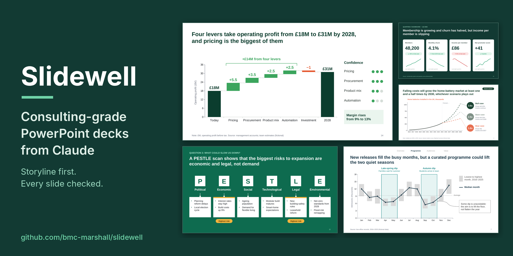
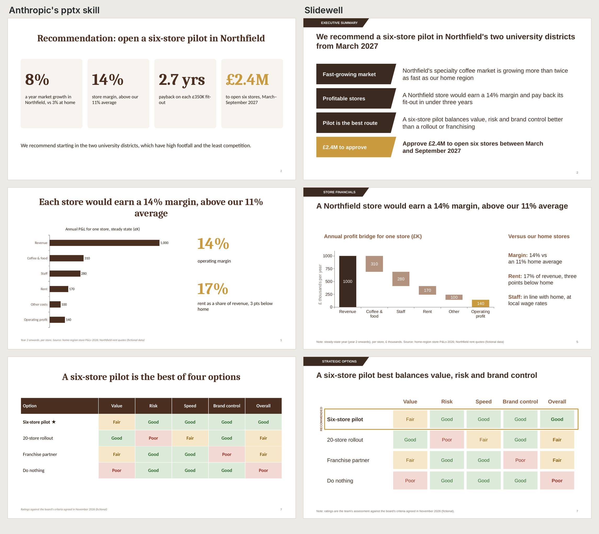
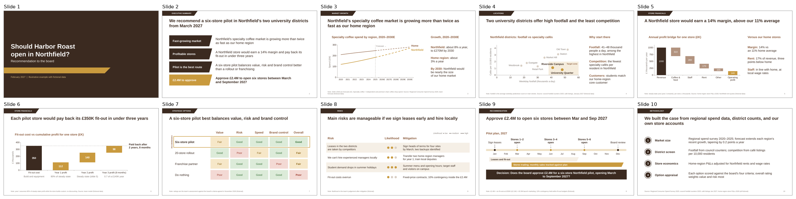
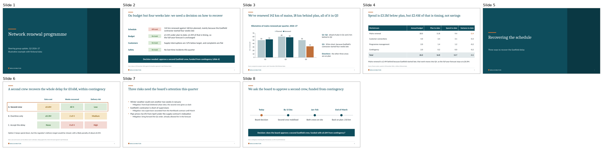
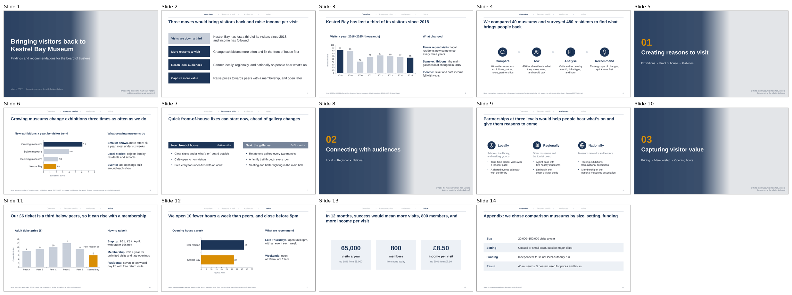
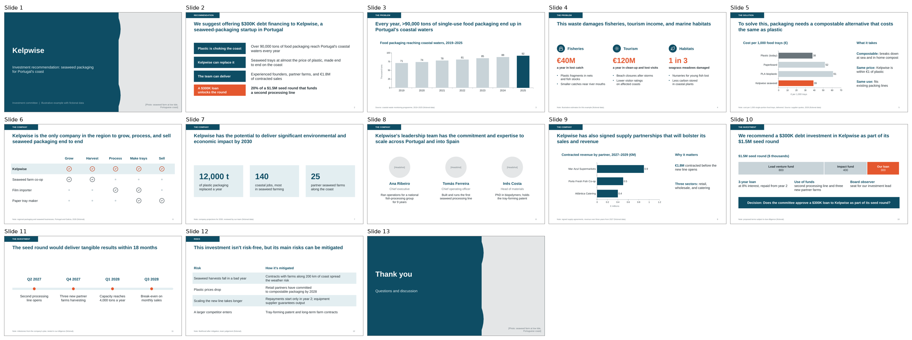
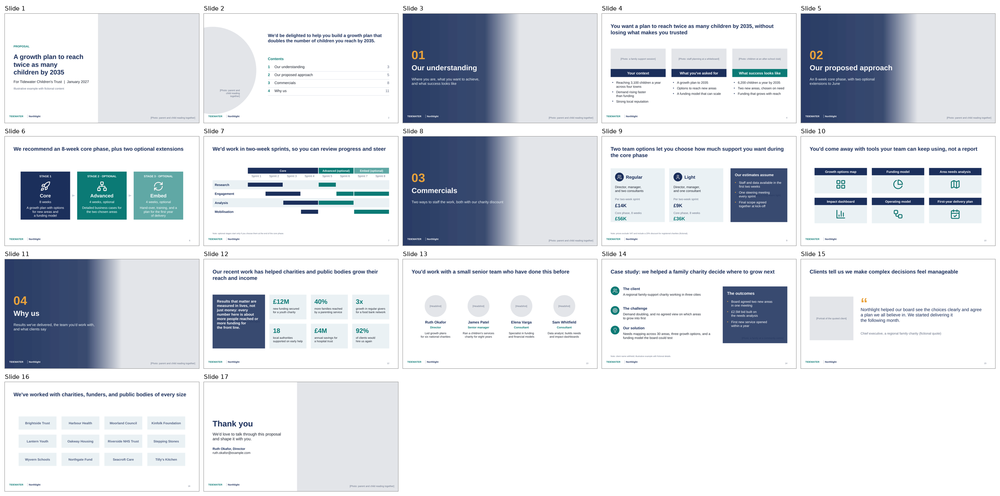
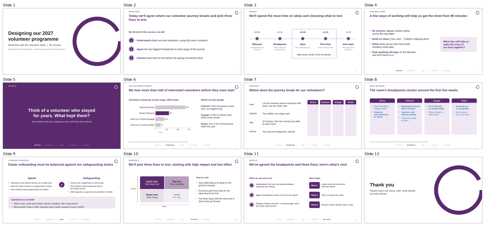
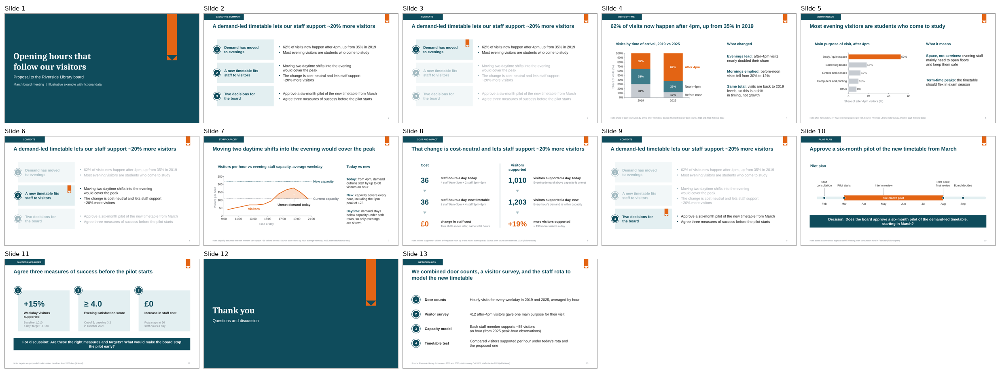

# Slidewell

[](https://github.com/bmc-marshall/slidewell/actions/workflows/test.yml)
[](LICENSE)
[](#install)

**Consulting-grade PowerPoint decks from Claude. The story is agreed before anything is built, and every slide is checked before you see it.**

Give Claude your notes, data or a rough brief. Slidewell asks a few sharp questions, proposes the storyline headline by headline for you to approve, then builds a native, fully editable `.pptx` in your brand or inside your own template, and checks it before you open it.



<sub>All slides above are from `slidewell/examples/showcase.pptx`, built and checked by Slidewell. Every organisation and figure is fictional.</sub>

---

## Same brief, two skills

We gave Claude the same request and analysis notes twice: once with Anthropic's general `pptx` skill, once with Slidewell. Both decks are native and editable. The difference is in what the slides say and how they're finished.



| | Anthropic `pptx` skill | Slidewell |
|---|---|---|
| Executive summary | Four big numbers | The argument: three reasons and the decision, each in one line |
| Store economics | A bar chart of the P&L | A profit bridge from revenue to operating profit, with the comparison to home stores beside it |
| Headlines | Some name the topic ("The main risks can be managed") | Each states the finding and how ("Main risks are manageable if we sign leases early and hire locally") |
| Finishing problems found by Slidewell's checker | 1 error, 38 warnings: words left alone on a line, headlines with one word on line two, a hidden chart axis, cramped or uneven spacing, charts without alt text | 0 errors, 9 warnings |

The checker is Slidewell's own, so read those counts as "how far from Slidewell's standard", not a neutral score. The slides are the fairer comparison. Both full decks, the brief and the build script are in [`docs/comparison/`](docs/comparison) so you can rerun it yourself.

## Why Slidewell

AI-built decks usually fail in one of two ways. Slidewell is designed around preventing both.

**1. The slides look fine, but the story is wrong.** Most tools start drawing straight away. Slidewell starts with the argument: the answer first, three to five supporting points, and a headline on every slide that states the point instead of naming the topic. You approve that storyline before a single slide is built, so you never spend twenty minutes fixing the design of the wrong deck.

**2. The story is fine, but the slides are full of small errors that get worse with every revision.** Misaligned boxes, three shades of nearly the same blue, a headline that leaves one word on its second line, numbers that don't add up. Slidewell builds from one theme spec, follows a written finishing standard, and runs an automated checker (63 checks), a visual review and an arithmetic check before delivery. When you ask for changes, it keeps a log of everything you've already approved and flags any change to a slide you didn't ask it to touch.

Read the headlines of any Slidewell deck on their own and you get the whole argument:


## What it makes

| You ask for | You get |
|---|---|
| **A recommendation or findings deck** | Answer-first storyline, charts whose titles carry the message, sources on every data slide, a clear decision slide |
| **An options appraisal** | A shortlist scored against agreed criteria, with the recommended option highlighted and the trade-offs visible |
| **A board paper or steering-group update** | Progress, RAG status, risks and the decisions needed, in the order a board reads them |
| **A deck in your company template** | Your masters, layouts, fonts, colours and page numbers, with Slidewell's content and checks on top |
| **A proposal or pitch** | Leads with the client's goals, then approach, plan, pricing and team; credentials last |
| **A workshop deck** | Objectives, a timed agenda tracked through the deck, exercises, capture slides, and a share version afterwards with the room's input added |
| **A template** | Styled example slides of every kind you'll need, in your brand, with placeholder text |
| **Three options for one slide** | Three structurally different versions next to the original, with a recommendation |
| **A fix to an existing deck** | The change you asked for, and nothing else moved |

Every deck is a native PowerPoint file: real text boxes, real bullets, native editable charts, alt text on every chart. No images of slides, no HTML.

## How it works

1. **Intake.** Two short rounds of questions: what the audience should think or do afterwards, who they are, the deck type, the brand, and how hands-on you want to be. It skips anything you've already told it, and if you say "just go", it states its assumptions and carries on. Short decks (five slides or fewer) take a lighter route.
2. **Storyline.** Every headline in order, with what will prove each one. You approve or redirect it in one message.
3. **Look.** Builds inside your template if you have one, matches the client's brand if you don't, and offers to keep the style of any deck you share as a reference.
4. **Build.** Layouts chosen per slide from a library of tested patterns: charts, profit bridges, options grids, timelines, phased plans, team pages and more.
5. **Check.** 63 automated checks: fonts, sizes, wrapping, orphans, spacing, alignment, colour, corners, positions across slides, sources, alt text and arithmetic. Then a visual review of every rendered slide, in up to three rounds.
6. **Deliver.** The `.pptx`, plus a short note of what was checked, what was fixed, and anything it couldn't verify.

## Install

**Claude apps (claude.ai and desktop)**
1. Download `slidewell.zip` from the [latest release](https://github.com/bmc-marshall/slidewell/releases/latest).
2. In Claude, open **Customize → Skills**, click **+**, choose **Upload a skill**, and select the zip.
3. Make sure code execution and file creation is turned on in Settings. Works on all plans, including Free.

**Claude Code** (plugin, updates with `/plugin`)
```
/plugin install slidewell --marketplace bmc-marshall/slidewell
```
On older versions of Claude Code: `/plugin marketplace add bmc-marshall/slidewell`, then `/plugin install slidewell@slidewell`.

**Claude Code, Codex, Cursor and other agents** (via the [skills CLI](https://skills.sh))
```bash
npx skills add bmc-marshall/slidewell
```

**Manually:** copy the `slidewell` folder into your agent's skills folder (for Claude Code, `~/.claude/skills/`) and run `pip install -r slidewell/requirements.txt`.

**Requirements:** Python 3.9+ with `python-pptx`, `lxml` and `Pillow`. Optional, for the visual review: LibreOffice and Poppler. Claude's own code environment already has everything. On a laptop without LibreOffice, Slidewell still runs every automated check and tells you the visual review was skipped. It works on macOS, Windows and Linux.

## Try it

> Make a 10-slide recommendation deck for our board from the attached analysis.

> Here's our company template. Build this month's steering-group update in it.

> I'm running a 90-minute workshop with our volunteer leads next Tuesday. Build the deck.

> Give me three options for this executive summary slide.

> Tidy up slide 4. Don't touch anything else.

You don't need to say "Slidewell". Claude uses it whenever you ask for a PowerPoint deck.

## Examples

Ten complete decks, each with the script that built it, in [`slidewell/examples/`](slidewell/examples). Every one is rebuilt and checked automatically on each change.

| | Deck | Type | What to look at |
|---|---|---|---|
|  | `market-entry-recommendation.pptx` | Recommendation with options | Forecast line, scatter with a target zone, profit bridge, payback chart, RAG options grid |
|  | `brackwater-update.pptx` | Steering-group update **in a corporate template** | The template's own layouts, title and body placeholders, bullet styles and page numbers; status chips, chart, table, options and decision |
|  | `museum-turnaround.pptx` | Findings and recommendations | Three MECE sections, a section tracker, charts with a "what this means" panel |
|  | `kelpwise-pitch.pptx` | Investment pitch | Each headline answers the last; big-number impact slide; funding stack |
|  | `consulting-proposal.pptx` | Proposal | Co-branded, phased offer, sprint plan, pricing options, team, case study |
|  | `volunteer-workshop.pptx` | Workshop | Objectives, tracked agenda, exercises, capture slide |
|  | `library-recommendation.pptx` | Recommendation | Charts with takeaways, show-the-math, pilot plan and decision bar |

Also included: `purbeck-social-impact-club.pptx` (a seven-slide case for action), `fundraising-workshop.pptx` (a method revealed step by step on click), `animation-options.pptx` (three ways to reveal the same slide), and the fictional corporate template itself, `examples/templates/brackwater-template.pptx`, to try template mode with.

## How Slidewell compares

| | Slidewell | General PowerPoint skills | Claude for PowerPoint add-in | HTML slide skills |
|---|---|---|---|---|
| Native, editable `.pptx` | ✓ | ✓ | ✓ (inside PowerPoint) | Needs conversion |
| Storyline approved before building | ✓ | – | You prompt for it | – |
| Works inside your corporate template | ✓ | Varies | ✓ | – |
| Written finishing standard + automated checker | ✓ (63 checks) | Some have a linter or visual check | – | – |
| Arithmetic, source and alt-text checks | ✓ | – | – | – |
| Protects approved slides during revisions | ✓ | – | Edits in place | – |
| Workshop decks and share versions | ✓ | – | – | – |
| Works on the Free plan | ✓ | ✓ | Pro and above | ✓ |

They work well together: build the deck with Slidewell, then make last-minute edits in PowerPoint with the add-in.

## Check any deck, even one Slidewell didn't make

The checker works on its own, on any `.pptx`: your team's decks, a template, or another tool's output.

```bash
pip install git+https://github.com/bmc-marshall/slidewell
slidewell-check my-deck.pptx              # errors and warnings, slide by slide
slidewell-check my-deck.pptx --numbers    # every number on every slide, for an accuracy pass
slidewell-check my-deck.pptx --json       # machine-readable, for CI
slidewell-render my-deck.pptx             # slide images and a contact sheet (needs LibreOffice)
slidewell-compare v1.pptx v2.pptx --focus 4   # what changed, and what changed that shouldn't have
```

It catches what reviewers usually catch by eye: text below readable sizes, more than two fonts, words left alone on a line or broken mid-word, headlines that wrap badly, boxes that are almost (but not exactly) aligned or the same size, headlines and page numbers that jump between slides, off-palette colours, pie and 3D charts, hidden axes, data with no source, charts with no alt text, and totals that don't add up.

## What's inside

| File | Purpose |
|---|---|
| `slidewell/SKILL.md` | What Claude reads first: modes, the storyline gate, build, QA and delivery |
| `references/intake.md` | The questions, with sample answers, and the slides each deck type needs |
| `references/storytelling.md` | Pyramid principle, grouping and order, SCQA, headlines |
| `references/storyline-examples.md` | Worked storylines, weak patterns and how to fix them |
| `references/visual-identity.md` | Brand, palette, motifs, type, shape vocabulary, animation |
| `references/layout-patterns.md` | Which layout each slide uses, and how it's built |
| `references/charts.md` | Whether to chart, which chart, and the finishing details |
| `references/finishing-standard.md` | Every finishing rule with its reason, and whether the checker tests it |
| `references/review-brief.md` | What the internal reviewer looks for in each round |
| `references/qa.md` | The QA loop, accuracy pass and checklists |
| `scripts/` | Checker, renderer, version comparison, and the build library (including template mode) |
| `assets/icons.zip` | 114 icons from [Lucide](https://lucide.dev) (ISC licence), packed in one file and recoloured to your brand; names in `assets/icons.txt` |
| `tests/` | Rebuilds every example and tests the checker, template mode and fallbacks |

## Limitations

- A full deck takes about 10–20 minutes and a fair share of a Free or Pro plan's usage. Start long builds in a fresh conversation. Short decks use a lighter route.
- Fonts that aren't installed where Claude runs are measured with metric-compatible stand-ins where they exist (Calibri, Cambria, Arial, Times New Roman). For other brand fonts, Slidewell leaves extra room in text boxes and asks you to check fit on your machine.
- Photos are placeholder frames labelled with the picture each one needs. Add your own images in PowerPoint.
- It writes PowerPoint. For Google Slides, import the `.pptx`; Keynote opens it directly.

## Contributing

Issues and pull requests are welcome. If a deck came out wrong, open an issue with a screenshot of the slide and the checker's output. New layout patterns and checker rules are especially welcome: please add an example or a test that exercises them. See [CONTRIBUTING.md](CONTRIBUTING.md).

## Licence

MIT, © 2026 Ben Marshall. Icons from Lucide under the ISC licence.

Made by **Ben Marshall**. Also by the same author: [choosewell](https://github.com/bmc-marshall/choosewell), options appraisal with Claude.
